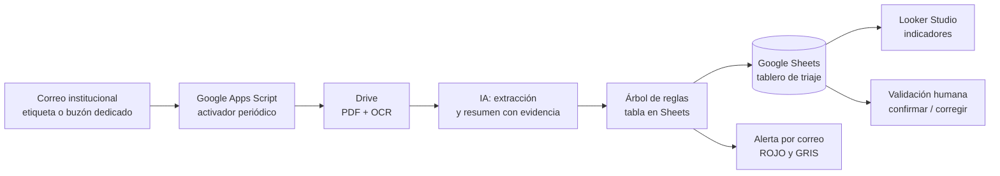
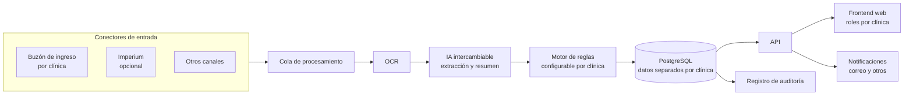

# Triaje asistido de tutelas — Propuestas

Reto Kantera – Universidad Nacional de Colombia · Clínica Universitaria Colombia (Keralty / Colsanitas)

> El presupuesto de cada propuesta está en [PRESUPUESTO.md](PRESUPUESTO.md).

> **Estado:** propuesta inicial, construida solo con la información compartida por Kantera (documento de antecedentes del 27 de octubre de 2026 y base sintética de 60 casos). Todavía no se ha validado con usuarios ni con las áreas implicadas. Todos los datos de prueba son ficticios.

---

## Contenido

1. [El problema](#1-el-problema)
2. [Qué hace y qué no hace la solución](#2-qué-hace-y-qué-no-hace-la-solución)
3. [Información disponible](#3-información-disponible)
4. [Núcleo compartido](#4-núcleo-compartido)
5. [Propuesta A — Piloto en la clínica](#5-propuesta-a--piloto-en-la-clínica)
6. [Propuesta B — Plataforma para la red Keralty](#6-propuesta-b--plataforma-para-la-red-keralty)
7. [Comparación](#7-comparación)
8. [Supuestos por validar](#8-supuestos-por-validar)
9. [Próximos pasos](#9-próximos-pasos)

---

## 1. El problema

Los líderes asistenciales y administrativos de la clínica reciben tutelas que deben leer, entender y direccionar en plazos muy cortos, y muchos de ellos no tienen formación jurídica. Hoy el proceso es manual:

- Las tutelas llegan por **correo institucional** (PDF adjunto) y por **Imperium**, el aplicativo del proceso de EPS Sanitas. A veces el mismo caso llega primero por correo y aparece en Imperium al día siguiente.
- Una persona del equipo operativo descarga los documentos, lee el auto admisorio y verifica los plazos.
- No existe una matriz formal de priorización ni un catálogo validado de responsables.
- El volumen reportado es de **7 a 10 correos diarios** en el área de la proponente (Oncología).

**Lo que se busca:** reducir el tiempo de lectura, clasificación y búsqueda del responsable, y evitar que un plazo se venza, sin reemplazar la revisión jurídica ni el criterio institucional.

## 2. Qué hace y qué no hace la solución

La solución es un **triaje asistido**, no un sistema de resolución de tutelas.

| Sí hace | No hace |
|---|---|
| Recibe el documento y registra fecha, canal y adjunto | No responde al juzgado ni envía nada por su cuenta |
| Extrae el tipo de actuación, lo que se solicita y el plazo, citando el fragmento de origen | No descarta casos, ni siquiera los que parecen ajenos a la clínica |
| Resume la solicitud en lenguaje claro | No toma decisiones jurídicas ni clínicas |
| Sugiere prioridad y área responsable, explicando por qué | No infiere plazos que no estén en el documento |
| Detecta posibles duplicados | No usa datos reales sin autorización institucional |
| Alerta y permite hacer seguimiento | |

Toda sugerencia la revisa y confirma una persona.

**El error que más importa evitar** es que un caso urgente quede marcado como no urgente. Es la métrica principal de las dos propuestas.

## 3. Información disponible

La base sintética entregada por Kantera (`insumos/Base sintetica- Reto Tutelas. Kantera - UNAL_2026.xlsx`, no incluida en el repositorio) contiene:

| Hoja | Contenido |
|---|---|
| `02_Casos_sinteticos` | 60 casos con la clasificación de referencia (semáforo, área, competencia, duplicados) |
| `03_Textos_PDF` | Texto equivalente al PDF de cada caso |
| `04_Correos_simulados` | 60 correos de entrada enlazados por `ID_CASO` |
| `05_Reglas_propuestas` | 12 reglas (R01–R12) de ingreso, extracción, semáforo, direccionamiento, duplicados, ejecución y seguridad |
| `06_Catalogos` | Tipos de actuación, colores del semáforo y competencia |
| `08_Tablero_Triaje` | Vacía; pensada para el resultado del prototipo |

Distribución de los casos:

- **Tipo de actuación:** medida provisional (15), incidente de desacato (12), fallo u orden judicial (11), auto admisorio o traslado (9), comunicación complementaria (7), requerimiento de informe (6).
- **Semáforo de referencia:** ROJO 31 · AMARILLO 18 · GRIS 8 · VERDE 3.
- **Canal:** 20 casos solo por correo, 20 solo en Imperium y 20 por ambos.

Observaciones:

- Los textos siguen una plantilla muy uniforme. Un prototipo puede acertar casi siempre con estos datos y aun así fallar con documentos reales, por eso proponemos crear un **conjunto de prueba adicional "difícil"** (ver sección 4.4).
- La mitad de los casos son ROJO, así que un único color no basta para ordenar el trabajo (ver sección 4.3).

## 4. Núcleo compartido

Las dos propuestas comparten el mismo núcleo, así que la Propuesta A funciona como piloto de la B.

### 4.1 Esquema del caso

Cada documento que entra se convierte en un registro con estos campos:

| Campo | Descripción |
|---|---|
| `id_caso` | Identificador interno |
| `recibido_en`, `canal` | Fecha y hora de recepción; correo, Imperium o ambos |
| `tipo_actuacion` | Según el catálogo (medida provisional, desacato, fallo…) |
| `peticion` | Qué se solicita, extraído del documento |
| `resumen` | Explicación breve en lenguaje claro |
| `plazo_literal`, `plazo_fecha` | El plazo tal como aparece en el texto, y su fecha si se pudo determinar |
| `evidencia` | Fragmento o apartado del documento del que sale cada dato |
| `competencia` | Potencialmente de la clínica / no clara / por validar |
| `urgencia_juridica`, `urgencia_clinica` | Ejes de prioridad (ver 4.3) |
| `semaforo`, `regla_aplicada` | Color resultante y regla que lo justifica |
| `area_sugerida` | Área responsable sugerida |
| `duplicado_de` | Caso relacionado, si existe |
| `confianza` | Qué tan segura es la extracción |
| `estado`, `validado_por`, `correccion` | Seguimiento y validación humana |

### 4.2 Reglas como datos

La decisión de prioridad y de área la toma un **árbol de reglas determinista**, no un modelo de IA:

- Las reglas viven en una **tabla** (condición → salida → advertencia), siguiendo el formato de `05_Reglas_propuestas`. Jurídica puede revisarlas y ajustarlas sin tocar código.
- Cada resultado indica qué regla lo produjo (por ejemplo: *"ROJO por R04: medida provisional"*).
- La IA solo **extrae y resume**. No hay datos reales etiquetados para entrenar un modelo confiable, y una decisión explicable es lo que necesita el equipo jurídico para confiar en el sistema.

### 4.3 Priorización en dos ejes

Para no confundir la prioridad operativa con los términos legales, se separan dos ejes:

- **Urgencia jurídica:** tipo de actuación y horas que faltan para el plazo.
- **Urgencia clínica:** señales de riesgo para el paciente mencionadas en el documento.

Se mantienen los colores de la base:

| Color | Cuándo (reglas de referencia R03–R07) |
|---|---|
| 🔴 ROJO | Plazo aparentemente vencido, medida provisional, incidente o riesgo clínico |
| 🟡 AMARILLO | Plazo de 24 h o menos sin alerta mayor |
| 🟢 VERDE | Plazo mayor de 24 h sin alerta mayor |
| ⚪ GRIS | Competencia incierta, posible duplicado o texto incompleto: requiere revisión antes de asignar |

Dentro de cada color, los casos se ordenan por **horas restantes**. Los umbrales son provisionales y configurables.

El color **GRIS** nunca descarta un caso: lo envía a revisión indicando el motivo.

### 4.4 Evaluación

- **Conjunto base:** los 60 casos, comparando la salida con `SEMAFORO_REFERENCIA` y `AREA_SUGERIDA_FICTICIA`.
- **Conjunto difícil (por construir):** los mismos casos con redacción variada, fechas escritas en palabras, PDFs escaneados y documentos incompletos.
- **Métricas:**
  1. Casos urgentes (ROJO o GRIS) que quedaron como VERDE: **la meta es cero**.
  2. Exactitud del semáforo y del área.
  3. Duplicados detectados frente a los esperados.
  4. Tiempo de procesamiento por caso.

---

## 5. Propuesta A — Piloto en la clínica

**Una solución austera dentro de las herramientas que la clínica ya tiene, para demostrar el valor con costo casi nulo.**

### 5.1 Arquitectura

### 5.2 Componentes

| Componente | Herramienta | Función |
|---|---|---|
| Ingreso | Google Apps Script + Gmail | Revisa periódicamente una etiqueta o buzón dedicado, toma el PDF y registra fecha, canal y adjunto |
| Lectura | Drive (OCR) | Convierte el PDF a texto; si la calidad es baja, el caso pasa a GRIS |
| Extracción | IA (Gemini institucional o equivalente) | Devuelve los campos del esquema en JSON, cada uno con su fragmento de evidencia |
| Decisión | Árbol de reglas | Asigna semáforo, área y regla aplicada |
| Gestión | Google Sheets | Cola de trabajo con columnas de validación: de acuerdo / corrección / quién revisó / estado |
| Alertas | Correo desde Apps Script | Aviso inmediato para casos ROJO y GRIS |
| Seguimiento | Looker Studio | Casos por color, horas restantes, carga por área, porcentaje de correcciones y vencimientos |

### 5.3 Decisiones de diseño

- **Apps Script** no requiere servidor ni presupuesto y opera dentro del entorno institucional. Sus límites (ejecuciones de 6 minutos, cuotas diarias) sobran para el volumen reportado.
- **La IA queda aislada** en un solo módulo, para poder cambiarla por la opción que apruebe TI (Gemini en Workspace, Vertex AI o un modelo local). Con datos reales no se usarán APIs públicas.
- **Looker Studio solo muestra indicadores.** No permite asignar ni corregir casos, y tarda en reflejar los cambios. La gestión se hace en Sheets y las alertas urgentes salen por correo.
- **El correo es la única puerta de entrada.** Los casos que también aparecen en Imperium se marcan como duplicados al compararlos con lo ya registrado, conservando la traza de ambos ingresos.

### 5.4 Alcance del piloto

- Área: **Oncología**. Las demás áreas quedan como extensión.
- Datos: **solo sintéticos** hasta contar con autorización institucional.
- Demo: un correo sintético entra, se procesa en menos de un minuto y aparece en la hoja con color, evidencia, regla aplicada y área sugerida; luego se refleja en el tablero de Looker.

### 5.5 Requisitos para pasar a datos reales

- Aprobación de TI, Jurídica, Seguridad de la Información y Protección de Datos.
- Definición del buzón de ingreso.
- Proveedor de IA autorizado.
- Catálogo oficial de áreas y umbrales validados por Jurídica.

---

## 6. Propuesta B — Plataforma para la red Keralty

**Llevar el mismo núcleo a una plataforma propia que atienda a las clínicas de la red Keralty / Colsanitas.**

Esta propuesta se presenta como **visión y hoja de ruta**. Su desarrollo depende de los resultados del piloto (Propuesta A).

### 6.1 Arquitectura

### 6.2 Componentes

| Componente | Descripción |
|---|---|
| Conectores de entrada | El **buzón de ingreso por clínica** es el canal base y obligatorio. Imperium es un conector opcional, sujeto a que exista una integración autorizada. La arquitectura admite otros canales, por si alguna clínica de la red recibe tutelas por medios distintos. |
| Procesamiento | Cola asíncrona: ingreso → OCR → extracción → reglas → registro |
| IA | Capa intercambiable según lo que autorice cada clínica o la red |
| Motor de reglas | El mismo de la Propuesta A, con reglas, umbrales, áreas y responsables configurables por clínica |
| Base de datos | PostgreSQL con identificador de clínica y seguridad a nivel de fila: ninguna clínica ve los datos de otra |
| Backend y API | FastAPI o Node; expone los casos, las reglas y las integraciones |
| Frontend | Aplicación web para la gestión y el seguimiento de casos, sin depender de herramientas externas |
| Notificaciones | Los implicados reciben avisos por correo y responden desde la plataforma |
| Auditoría | Registro de quién vio, cambió o validó cada caso |

### 6.3 Roles

| Rol | Puede |
|---|---|
| Operativo | Ver la cola de ingreso, validar extracciones y gestionar duplicados |
| Jurídica | Revisar y confirmar la clasificación; ajustar las reglas de su clínica |
| Líder de área | Ver y gestionar los casos asignados a su área |
| Administrador de clínica | Gestionar usuarios, áreas, responsables y umbrales |
| Administrador de red | Ver indicadores consolidados entre clínicas, sin acceso a casos individuales salvo autorización |

### 6.4 Decisiones de diseño

- **El alcance es la red Keralty / Colsanitas.** Las clínicas comparten grupo empresarial y relación con Sanitas, lo que hace el despliegue realista y permite reglas y catálogos comunes.
- **No se leen los buzones personales.** Pedir acceso a los correos de cada implicado es invasivo y difícil de aprobar. Cada clínica reenvía a su buzón de ingreso y los implicados reciben notificaciones.
- **Imperium no es una dependencia.** Si no hay integración, la plataforma funciona solo con el correo.
- **El núcleo es común a todas las clínicas y la configuración es propia de cada una**, para no mantener una versión distinta por clínica.

### 6.5 Datos y aspectos legales

Al atender varias clínicas de la red y manejar datos de salud, hay que resolver estos puntos antes de cualquier despliegue:

- **Ley 1581 de 2012:** cada clínica es responsable del tratamiento de los datos y la plataforma actúa como encargada. Se requieren contratos de transmisión de datos.
- **Aislamiento** de la información entre clínicas.
- **Alojamiento:** dónde quedan los datos y si hay transferencia internacional.
- **Seguridad:** controles alineados con estándares como ISO 27001, cifrado y auditoría de accesos.
- **Conservación:** tiempos de retención de documentos y registros.

Estos puntos se plantean como **condiciones previas**, no como temas resueltos.

### 6.6 Valor adicional frente a la Propuesta A

- Vista consolidada de la red: temas recurrentes, áreas con más carga y vencimientos por clínica.
- Reglas y buenas prácticas compartidas entre clínicas.
- Menor costo por clínica al compartir la infraestructura.
- Gestión completa dentro de una sola herramienta.

### 6.7 Entregables dentro del reto

No se construye nada en producción. Se entrega:

- Arquitectura de referencia.
- Maqueta de las pantallas principales.
- Hoja de ruta por fases.
- Estimado de costos de infraestructura y operación.

### 6.8 Hoja de ruta

| Fase | Contenido | Condición para avanzar |
|---|---|---|
| 0 | Núcleo compartido y evaluación con datos sintéticos | — |
| 1 | Propuesta A: piloto en Oncología | Aprobaciones institucionales |
| 2 | Extensión a otras áreas de la clínica | Métricas del piloto favorables |
| 3 | Plataforma B en una segunda clínica de la red | Patrocinio, acuerdo de datos y equipo técnico |
| 4 | Despliegue en la red y conectores adicionales | Resultados de la fase 3 |

---

## 7. Comparación

| | Propuesta A: Piloto en la clínica | Propuesta B: Plataforma para la red Keralty |
|---|---|---|
| Objetivo | Demostrar el ahorro de tiempo y que no se escapen casos urgentes | Llevar el mismo núcleo a las clínicas de la red |
| Alcance | Una clínica, empezando por Oncología | Clínicas de la red Keralty / Colsanitas |
| Tecnología | Apps Script, Drive, Sheets, Looker Studio | Backend propio, PostgreSQL, frontend web |
| Entrada | Correo | Buzón por clínica, Imperium opcional y otros canales |
| Seguimiento | Sheets + Looker Studio | Dentro de la plataforma |
| Costo | Casi nulo | Requiere inversión en infraestructura y equipo |
| Requisitos | Aprobación de TI para el buzón y la IA | Métricas de A, acuerdo de datos y decisión sobre Imperium |
| Entregable en el reto | Prototipo funcionando | Arquitectura, maqueta, hoja de ruta y costos |

**La Propuesta A genera la evidencia que justifica la Propuesta B.**

## 8. Supuestos por validar

Estos supuestos se basan solo en la información disponible. El diseño está pensado para seguir funcionando si alguno resulta falso.

| Supuesto | Qué cambia si es falso | Cómo se valida |
|---|---|---|
| El volumen es de 7 a 10 correos diarios en el área | Con un volumen mucho mayor, la Propuesta A podría chocar con las cuotas de Apps Script y se adelantaría la B | Medición de volumen por canal y área |
| Los documentos llegan en PDF y algunos están escaneados | Si muchos están escaneados, la calidad del OCR pesa más y aumentan los casos en GRIS | Muestra de documentos (anonimizada o recreada) |
| Hay Google Workspace, pero no se sabe si incluye Gemini | La IA se conecta por un proyecto de Google Cloud o un modelo local; solo cambia ese módulo | Consulta a TI |
| Imperium no tiene integración disponible | Si existe, se agrega como conector; si no, todo funciona con el correo | Consulta al administrador de Imperium |
| Los umbrales del semáforo (24 h) son provisionales | Solo se ajusta la tabla de reglas, no el código | Revisión con Jurídica |
| El catálogo de áreas y responsables es provisional | Se reemplaza la tabla por el catálogo oficial | Revisión con la clínica |
| No se usarán datos reales sin autorización | — (es una condición, no un supuesto) | Acuerdo con Jurídica y Protección de Datos |

## 9. Próximos pasos

1. Implementar el núcleo compartido: esquema del caso, tabla de reglas y evaluación con los 60 casos sintéticos.
2. Construir el conjunto de prueba "difícil".
3. Prototipo de la Propuesta A con datos sintéticos (Apps Script, Sheets, Looker Studio).
4. Documentar la arquitectura, la maqueta y la hoja de ruta de la Propuesta B.
5. Presentar las dos propuestas y llevar los supuestos de la sección 8 a la primera reunión de validación.

---

## Aviso

Material de uso académico para el reto Kantera – Universidad Nacional. Todos los casos, textos y correos de prueba son ficticios. Este documento no autoriza el tratamiento de información sensible ni la intervención en el proceso institucional de tutelas. Las clasificaciones del sistema son sugerencias que siempre requieren revisión humana jurídica y clínica.
